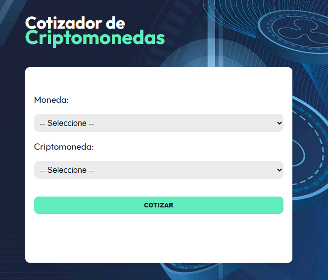
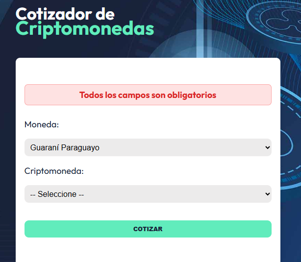
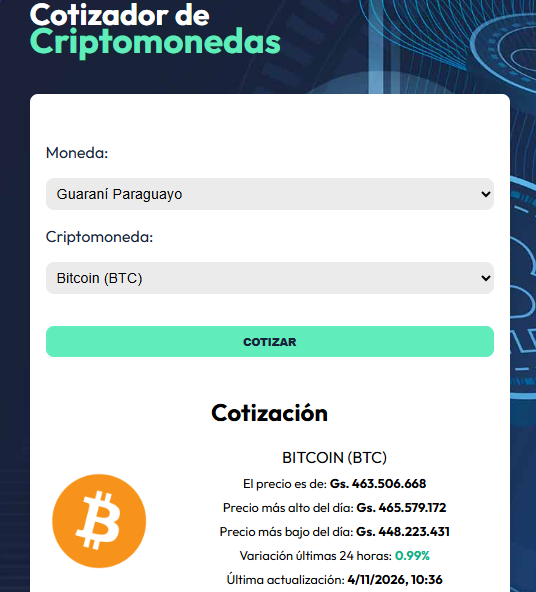

# Cotizador de Criptomonedas

Aplicación web desarrollada con React y TypeScript que permite consultar en tiempo real el precio de las principales criptomonedas del mercado. Los usuarios pueden seleccionar una moneda fiat y una criptomoneda para obtener información detallada sobre su cotización actual.

## 🚀 Características

- **Consulta de precios en tiempo real**: Obtén el precio actual de las top 10 criptomonedas por capitalización de mercado
- **Múltiples monedas fiat**: Consulta precios en Guaraní Paraguayo (PYG), Dólar Estadounidense (USD), Peso Mexicano (MXN), Euro (EUR) y Libra Esterlina (GBP)
- **Conversión para PYG**: CoinGecko no soporta PYG directamente, por lo que la app consulta el precio en USD y lo convierte usando la tasa de cambio del día
- **Información detallada**: Visualiza precio actual, máximo y mínimo del día, variación en 24 horas y última actualización
- **Formato de moneda local**: Los precios se formatean con el locale apropiado de cada moneda
- **Interfaz intuitiva**: Diseño limpio y fácil de usar
- **Validación de datos**: Utiliza Zod para validar y tipar las respuestas de la API
- **Estado global**: Gestión de estado con Zustand para una experiencia fluida

## 🛠️ Tecnologías Utilizadas

### Frontend
- **React 19.1.1**: Biblioteca de JavaScript para construir interfaces de usuario
- **TypeScript 5.9.3**: Superset de JavaScript que añade tipado estático
- **Vite 7.3.7**: Herramienta de construcción y desarrollo ultrarrápida

### Gestión de Estado
- **Zustand 5.0.8**: Biblioteca ligera para manejo de estado global

### Validación y Tipado
- **Zod 4.1.11**: Biblioteca de validación de esquemas TypeScript-first

### Peticiones HTTP
- **Axios 1.12.2**: Cliente HTTP basado en promesas para realizar peticiones a APIs

### APIs Externas
- **CoinGecko API**: API gratuita para obtener datos de criptomonedas
  - Endpoint de listado: `https://api.coingecko.com/api/v3/coins/markets`
  - Endpoint de cotización: `https://api.coingecko.com/api/v3/coins/markets`
- **ExchangeRate-API**: API gratuita para obtener tasa de cambio USD → PYG
  - Endpoint: `https://open.er-api.com/v6/latest/USD`

> **Nota**: CoinGecko no requiere autenticación para los endpoints básicos utilizados, pero tiene límites de uso (rate limits). Si superas esos límites, deberías considerar obtener una API key gratuita.

### Herramientas de Desarrollo
- **ESLint**: Linter para mantener la calidad del código
- **TypeScript ESLint**: Reglas de linting específicas para TypeScript
- **@vitejs/plugin-react-swc**: Plugin de Vite con soporte para React y SWC (compilador rápido)

## 📋 Requisitos Previos

Antes de comenzar, asegúrate de tener instalado en tu sistema:

- **Node.js** (versión 18 o superior)
- **npm** (viene incluido con Node.js) o **yarn**

Puedes verificar si los tienes instalados ejecutando en tu terminal:

```bash
node --version
npm --version
```

## 🔧 Instalación

1. **Clona el repositorio**

   ```bash
   git clone https://github.com/YamilGZ/react-cripto-app-ygz.git
   ```

2. **Navega al directorio del proyecto**

   ```bash
   cd react-cripto-app-ygz
   ```

3. **Instala las dependencias**

   ```bash
   npm install
   ```

   O si prefieres usar yarn:

   ```bash
   yarn install
   ```

## 🚀 Ejecución

### Modo Desarrollo

Para ejecutar la aplicación en modo desarrollo con hot-reload:

```bash
npm run dev
```

O con yarn:

```bash
yarn dev
```

La aplicación estará disponible en `http://localhost:5173` (o el puerto que Vite asigne automáticamente).

### Compilar para Producción

Para crear una versión optimizada para producción:

```bash
npm run build
```

Los archivos compilados se generarán en la carpeta `dist/`.

### Vista Previa de Producción

Para previsualizar la versión de producción localmente:

```bash
npm run preview
```

### Linting

Para verificar el código con ESLint:

```bash
npm run lint
```

## 📁 Estructura del Proyecto

```
react-typescript-cripto/
├── src/
│   ├── components/          # Componentes React
│   │   ├── CriptoSearchForm.tsx
│   │   ├── CryptoPriceDisplay.tsx
│   │   ├── ErrorMessage.tsx
│   │   └── Spinner.tsx
│   ├── data/                # Datos estáticos (monedas fiat)
│   ├── helpers/             # Utilidades (formateo de moneda)
│   ├── schema/              # Esquemas de validación con Zod
│   ├── services/            # Servicios de API
│   │   └── CryptoService.ts
│   ├── store.ts             # Store de Zustand
│   ├── types/               # Definiciones de tipos TypeScript
│   ├── App.tsx              # Componente principal
│   ├── main.tsx             # Punto de entrada
│   └── index.css            # Estilos globales
├── public/                  # Archivos estáticos públicos
├── screenshots/             # Capturas de pantalla de la aplicación
├── dist/                    # Build de producción (generado)
├── package.json
├── tsconfig.json            # Configuración de TypeScript
├── vite.config.ts           # Configuración de Vite
└── README.md
```

## 📸 Capturas de Pantalla

### Pantalla inicial


### Validación de campos obligatorios


### Cotización de Bitcoin en Guaraní Paraguayo


## 🎯 Uso

1. Al cargar la aplicación, se obtienen automáticamente las top 10 criptomonedas
2. Selecciona una moneda fiat del primer dropdown (PYG, USD, EUR, ARS, etc.)
3. Selecciona una criptomoneda del segundo dropdown
4. Haz clic en "Cotizar" para ver la información detallada del precio
5. La aplicación mostrará:
   - Nombre y símbolo de la criptomoneda
   - Logo
   - Precio actual formateado según la moneda seleccionada
   - Precio más alto del día
   - Precio más bajo del día
   - Variación porcentual en las últimas 24 horas (verde si subió, rojo si bajó)
   - Última actualización

## 📝 Scripts Disponibles

- `npm run dev`: Inicia el servidor de desarrollo
- `npm run build`: Compila el proyecto para producción
- `npm run preview`: Previsualiza la build de producción
- `npm run lint`: Ejecuta ESLint para verificar el código


---

¡Disfruta cotizando criptomonedas! 🚀💰
